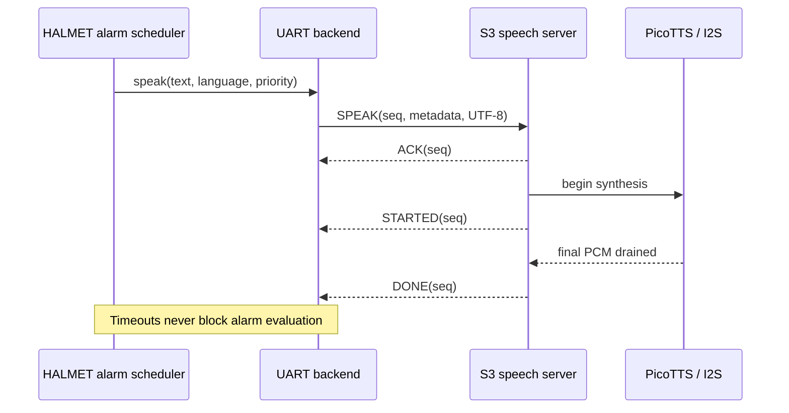

# Distributed Guardian architecture

## Design objective

The system applies separation of concerns and failure containment to audible
marine alarms. HALMET is the authority for alarm meaning; the ESP32-S3 is a
replaceable rendering service. This boundary prevents speech-engine resource
costs and failures from changing navigation-data semantics.

## Responsibility model

HALMET remains the marine application authority: Signal K and NMEA2000 source
arbitration, alarm table, severity, deduplication, acknowledgement, snooze,
repeat policy, configuration, display/LED and final language-specific text stay
there. `SpeechBackend` is the boundary; `UartSpeechBackend` only transports an
already composed request and tracks remote state. Failure or absence of S3 must
never stop HALMET alarm processing or its local indicators.

S3 owns frame validation, a bounded priority queue, PicoTTS, I2S/MAX98357A and
status/fault reports. It has no Signal K or NMEA2000 stack and does not reproduce
the Guardian alarm state machine. The portable `SpeechServer` implements command
semantics; `s3_main.cpp` connects it to UART0, PicoTTS and MAX98357A I2S.

## Architectural invariants

- Alarm state exists on HALMET; speech completion is never alarm acknowledgement.
- UART and BUSY are never used in a blocking wait on the HALMET event loop.
- Every accepted request is identified by sequence number; replaying a recent
  sequence cannot repeat speech.
- BUSY is observational. Framed lifecycle messages are authoritative.
- Invalid, oversized or corrupt input is silent and cannot escape fixed bounds.
- Update traffic is rejected unless a future implementation authenticates a
  signed manifest against a provisioned production trust root.

## Failure model

| Failure | Containment behavior |
|---|---|
| S3 absent, rebooting or stalled | HALMET local indication and alarm evaluation continue; UART request times out. |
| UART noise/truncation | CRC/length checks reject the frame; parser scans for the next magic word. |
| Duplicate request after retry | S3 ACKs a retained sequence without replaying it. |
| Queue saturation | S3 returns queue-full; it does not overwrite accepted work. |
| Critical alarm during lower-priority speech | Active lower-priority speech is interrupted and critical speech is scheduled. |
| Untrusted update bytes | Update is rejected fail-closed. |

Current implementation status:

- complete and host-tested: protocol, CRC/parser, SPEAK validation, queue,
  duplicate history, STOP, priority and portable HALMET/S3 interfaces;
- complete and compile-tested: S3 UART adapter, six-language PicoTTS,
  MAX98357A output and BUSY signaling;
- complete as a compile-tested HALMET environment: the upstream Guardian alarm
  application, existing configuration paths and UART backend integration;
- pending on hardware: runtime Signal K/N2K/OLED/LED/ACK compatibility and the
  physical HALMET pin/connector choices;
- A/B feasibility is measured. Updates remain fail-closed until a production
  signing key exists; ROM recovery requires the documented open-drain circuit.
