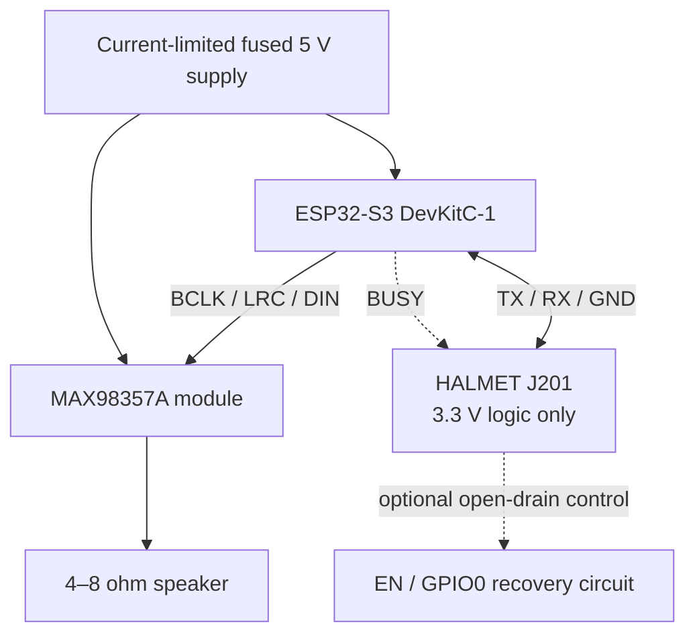

# Hardware reproduction guide

## Purpose and scope

This guide defines a reproducible **laboratory prototype** that connects a
HALMET controller, an ESP32-S3-DevKitC-1-N16R8V and a MAX98357A amplifier. It is
not a production PCB release, marine installation approval, or claim of
NMEA 2000 compliance. Published board documentation establishes candidate pins;
the exact assembled topology still requires inspection and measurement.

## Reproduction package

| Document | Role |
|---|---|
| [Bill of materials](bom.md) | Parts, alternatives, ratings and traceability identifiers. |
| [Reference schematic](schematic.md) | Nets, connector mapping and open-drain recovery circuit. |
| [Assembly](assembly.md) | Ordered no-power-first construction procedure. |
| [Verification](verification.md) | Acceptance measurements and an auditable result sheet. |
| [Reproducibility record](reproducibility.md) | Hardware/software metadata needed to repeat a result. |

The [BOM procurement section](bom.md#where-to-buy) links the exact HALMET,
16 MB ESP32-S3 board, documented MAX98357A breakout and example speaker.

## Authoritative source hierarchy

1. Exact board schematics and assembly drawings for the revision in hand.
2. Manufacturer data sheets for components and modules.
3. This reference design and its explicitly provisional assumptions.

The audit used the [HALMET hardware documentation](https://docs.hatlabs.fi/halmet/hardware/),
the [HALMET hardware repository](https://github.com/hatlabs/HALMET-hardware),
the [ESP32-S3-DevKitC-1 guide](https://docs.espressif.com/projects/esp-dev-kits/en/latest/esp32s3/esp32-s3-devkitc-1/user_guide_v1.0.html),
and the [MAX98357A data sheet](https://www.analog.com/media/en/technical-documentation/data-sheets/max98357a-max98357b.pdf).

## Safety invariants

- HALMET J201 is signal-only for this design; it supplies no approved 5 V rail.
- UART, BUSY, EN and GPIO0 are 3.3 V logic. Never apply 5 V to these nets.
- S3 USB power and external 5 V/VIN are mutually exclusive until the exact
  board's backfeed path has been reviewed and measured.
- EN and GPIO0 may be controlled only through separate open-drain devices with
  safe pull-up defaults; never drive them push-pull from HALMET.
- An ordinary shared-ground UART does not establish galvanic isolation. Treat
  the combined prototype as noncompliant until the complete vessel/USB/supply
  topology passes an engineering review.
- Use a fused, current-limited supply and begin audio tests at low volume.
