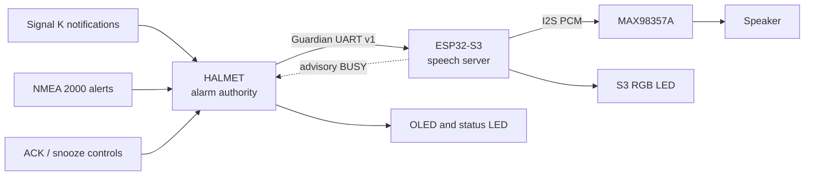

# HALMET–S3 Outlook Guardian documentation

## Abstract

HALMET–S3 Outlook Guardian is a distributed marine-alarm annunciator. A HALMET
controller remains authoritative for Signal K and NMEA 2000 alarm semantics,
while an ESP32-S3 coprocessor performs offline, multilingual text-to-speech.
The two processors communicate over a bounded, checksummed UART protocol. This
partition preserves alarm processing when speech hardware is absent and keeps
the speech image independent of vessel networks.

This documentation describes the software architecture, experimental hardware,
reproduction procedure and limits of the available evidence. A successful
build demonstrates source-level integration; it does **not** demonstrate safe
operation aboard a vessel. Statements use the following evidence labels:

| Label | Meaning |
|---|---|
| **Verified—host** | Demonstrated by deterministic tests on a development host. |
| **Verified—build** | Compiled and linked for the stated target. |
| **Specified** | Taken from a cited manufacturer or project source. |
| **Provisional** | A design candidate requiring review or measurement. |
| **Not tested** | No legitimate physical result is available. |

## System narrative

HALMET performs source arbitration, severity ordering, acknowledgement, snooze,
repetition and phrase composition. The S3 validates requests, schedules a
bounded priority queue, synthesizes PicoTTS audio and reports lifecycle events.
No S3 failure is allowed to block HALMET alarm processing or local indication.

## Reading map

1. [Installation and setup](installation.md) covers firmware flashing, wiring,
   first boot, Signal K, BLE remotes, mappings and acceptance tests.
2. [Getting started](getting_started.md) establishes a reproducible development
   playground and runs every hardware-independent check.
3. [Architecture](architecture.md) defines responsibilities, invariants and
   failure containment.
4. [UART protocol](protocol.md) specifies the wire format and provides examples.
5. [Hardware guide](hardware/index.md) contains the BOM, reference schematic,
   assembly procedure and measurement record.
6. [Test plan](test-plan.md) separates automated evidence from unperformed bench
   work.
7. [Upstream audit](upstream-audit.md) records provenance and compatibility.

## Current evidence boundary

The protocol, speech server and HALMET UART backend are host-tested, including
speech lifecycle, RGB, master-volume and all-language test commands. The HALMET
example, distributed Guardian and six-language S3 firmware are build-tested.
Signed UART update messages remain fail-closed until a production public trust
root and manifest policy are supplied. ROM recovery is unavailable until the
documented open-drain EN/GPIO0 circuitry physically exists. Prototype speech,
GPIO UART, USB protocol and BLE scanning have passed smoke tests. Power,
thermal, USB-backfeed and combined-system galvanic-isolation qualification has
not been performed and is not claimed.
