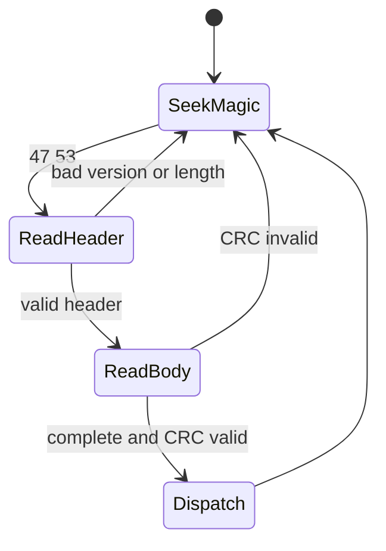

# Guardian UART protocol v1

## Scope

The protocol is a point-to-point, binary application protocol over 115200 baud,
8 data bits, no parity and one stop bit. It assumes a reliable electrical
3.3 V UART connection but treats bytes as an arbitrary fragmented stream. CRC
detects transmission errors; it provides no authenticity or confidentiality.

All multibyte integers are little-endian. A frame is:

| Offset | Bytes | Meaning |
|---:|---:|---|
| 0 | 2 | magic `47 53` (`GS`) |
| 2 | 1 | version, currently `01` |
| 3 | 1 | message type |
| 4 | 2 | sequence |
| 6 | 2 | payload length, 0 through 512 |
| 8 | N | payload |
| 8+N | 2 | CRC, low byte first |

The CRC is CRC-16/CCITT-FALSE: polynomial 0x1021, initial value 0xffff, no
reflection, xor-out zero. Coverage begins at version (offset 2) and ends at the
last payload byte; magic and the CRC field are excluded. There is no escaping.
Receivers scan for magic, validate version and length before accepting payload,
and resume scanning after any invalid frame. The maximum wire frame is 522 bytes.

The golden frame for SPEAK sequence 0x1234 with the two payload bytes `Hi` is:

```
47 53 01 10 34 12 02 00 48 69 e0 bc
```

### Decoder example

The golden frame decomposes as follows:

| Bytes | Interpretation |
|---|---|
| `47 53` | Resynchronization magic `GS` |
| `01` | Protocol version 1 |
| `10` | SPEAK message type |
| `34 12` | Sequence `0x1234`, little-endian |
| `02 00` | Two payload bytes |
| `48 69` | ASCII `Hi` (a minimal framing vector, not a valid structured SPEAK request) |
| `e0 bc` | CRC-16/CCITT-FALSE, little-endian |



## Types and semantics

`01 HELLO`, `02 CAPS`, `03 PING`, `04 PONG`, `10 SPEAK`, `11 STOP`,
`12 STATUS`, `13 ACK`, `14 STARTED`, `15 DONE`, `16 ERROR`, `17 SET_CONFIG`,
`18 SET_RGB`, `19 TEST_ALL`, `1A SET_VOLUME`,
`20 UPDATE_BEGIN`, `21 UPDATE_CHUNK`, `22 UPDATE_END`, `23 UPDATE_ABORT`,
`30 BT_GET_STATUS`, `31 BT_SET_ENABLED`, `32 BT_SCAN`, `33 BT_SCAN_STOP`,
`34 BT_CONNECT`, `35 BT_DISCONNECT`, `36 BT_FORGET`, `37 BT_STATE`, and
`38 BT_DEVICE`, `39 BT_HID_EVENT`, and `3A BT_TEST`.

ACK means only that a command was validated and accepted. STARTED means audio
began; DONE is emitted only after the speech engine reports idle (the hardware
adapter must include I2S drain in that definition). ERROR and DONE carry the
original sequence. HALMET retries with the same sequence; S3 retains the last 16
accepted SPEAK sequences and ACKs a duplicate without playing it again. Sequence
zero is reserved for unsolicited startup/status messages.

SPEAK contains one byte each for priority (0 low, 1 normal, 2 high, 3 critical),
volume (0-100), pitch (50-200), speed (50-200), then one byte of language length
(1-15), the ASCII BCP-47 language, and the final UTF-8 text. The total is at most
512 bytes. Invalid and overlong UTF-8, empty text, or out-of-range metadata is
rejected. The S3 queue holds eight requests, stable-sorted by priority. A full
queue returns ERROR/queue-full. Critical speech interrupts active lower-priority
speech; STOP cancels active speech and empties the queue. Other priorities do not
interrupt.

For example, a normal-volume Italian request for `Allarme motore` has the
logical payload below (the frame header and CRC are omitted):

```text
priority=1, volume=80, pitch=100, speed=100,
language_length=5, language="it-IT", text="Allarme motore"
```

ERROR payload byte codes are malformed=1, invalid-UTF8=2, queue-full=3,
unsupported=4, playback=5 and update-rejected=6.

BUSY is advisory only. UART STATUS and the ACK/STARTED/DONE state machine are
authoritative. Firmware adapters must poll in their event loops and must not wait
for UART output or speech completion.

SET_RGB lets HALMET control the ESP32-S3 board's RGB LED. Its payload is exactly
three bytes: red, green and blue intensity, each from 0 through 255. A valid
request returns ACK followed by DONE after the color is applied. Any other
payload length returns ERROR/malformed. Sending `00 00 00` turns the LED off.

TEST_ALL takes an empty payload and runs a complete audio self-test using one
sentence in each installed language, in this order: `en-US`, `en-GB`, `it-IT`,
`de-DE`, `es-ES`, and `fr-FR`. The six requests are reserved atomically so the
test either queues completely or returns ERROR/queue-full. The command returns
one ACK when accepted, one STARTED when the first sentence begins, and one DONE
after the final sentence drains. Repeating an accepted sequence is idempotent;
STOP cancels the active sentence and all remaining test sentences.

SET_VOLUME takes exactly one byte from 0 through 100 and sets the S3 master
output level until the next reboot or SET_VOLUME command. It returns ACK then
DONE after applying the value; an invalid length or value returns
ERROR/malformed. The master level multiplies the volume carried by each SPEAK
request, so a master level of 50 and a SPEAK volume of 80 produce 40% full-scale
PCM. HALMET stores its desired master level and sends it again whenever the S3
announces HELLO after boot.

## Bluetooth management

Wi-Fi is explicitly disconnected and placed in `WIFI_OFF` mode before the S3
starts BLE. BLE is enabled at every boot with the local name `Guardian-S3`; the
S3 acts as a BLE central so HALMET can manage a future media remote over USB or
UART without enabling an IP network.

`BT_GET_STATUS` has no payload and returns ACK, BT_STATE, DONE. BT_STATE is
three bytes: schema version (`01`), flags, and stored-bond count. Flag bits are
bit 0 enabled, bit 1 scanning, bit 2 connected, and bit 3 Wi-Fi-off. Reserved
bits must be ignored. `BT_SET_ENABLED` takes one byte, zero or one, and returns
ACK, BT_STATE, DONE. Disabling BLE stops a scan and disconnects the peer.

`BT_SCAN` takes a duration of 1 through 30 seconds. It returns ACK and STARTED
immediately, zero or more BT_DEVICE frames, then DONE. Each BT_DEVICE payload is
the 17-byte lowercase ASCII address, one ESP-IDF address-type byte, one signed
RSSI byte, and up to 48 UTF-8 name bytes. `BT_SCAN_STOP` has no payload and
returns ACK, DONE.

`BT_CONNECT` takes the same 17-byte ASCII address followed by its address-type
byte (0 public, 1 random, 2 public identity, 3 random identity). It returns ACK,
STARTED, then DONE or ERROR/playback after a five-second bounded attempt.
`BT_DISCONNECT` has no payload and returns ACK, DONE. `BT_FORGET` has no payload
and returns ACK, DONE after deleting every stored bond (and first disconnecting
the current peer).
HID media-key reports are carried without device-specific assumptions: after a connection the S3
pairs with bonding enabled, discovers HID service `1812`, and subscribes to
notifying Report (`2A4D`) characteristics. BT_HID_EVENT contains the little-
endian GATT characteristic handle followed by the raw HID report bytes. Live
events use sequence zero. `BT_TEST` takes no payload and returns ACK, the most
recent BT_HID_EVENT, and DONE; if no report has been received it returns
ERROR/playback. HALMET maps only the report bytes so reconnecting with a
different characteristic handle does not invalidate user mappings.

## Update messages

Types are allocated, but application updates remain fail-closed pending a
production signing trust root. The measured 7,327,219-byte image fits either
0x760000 A/B slot. Accepting unauthenticated bytes is forbidden.
