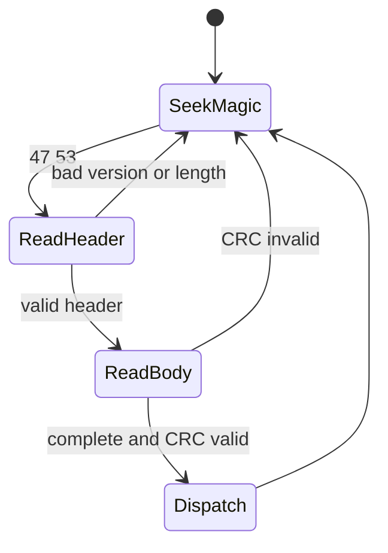

# Guardian UART protocol v1

## Scope

The protocol is a point-to-point, binary application protocol over 115200 baud,
8 data bits, no parity and one stop bit. It assumes a reliable electrical
3.3 V UART connection but treats bytes as an arbitrary fragmented stream. CRC
detects transmission errors; it provides no authenticity or confidentiality.

All multibyte integers are little-endian. A frame is:

| Offset | Bytes | Meaning |
|---:|---:|---|
| 0 | 2 | magic `47 53` (`GS`) |
| 2 | 1 | version, currently `01` |
| 3 | 1 | message type |
| 4 | 2 | sequence |
| 6 | 2 | payload length, 0 through 512 |
| 8 | N | payload |
| 8+N | 2 | CRC, low byte first |

The CRC is CRC-16/CCITT-FALSE: polynomial 0x1021, initial value 0xffff, no
reflection, xor-out zero. Coverage begins at version (offset 2) and ends at the
last payload byte; magic and the CRC field are excluded. There is no escaping.
Receivers scan for magic, validate version and length before accepting payload,
and resume scanning after any invalid frame. The maximum wire frame is 522 bytes.

The golden frame for SPEAK sequence 0x1234 with the two payload bytes `Hi` is:

```
47 53 01 10 34 12 02 00 48 69 e0 bc
```

### Decoder example

The golden frame decomposes as follows:

| Bytes | Interpretation |
|---|---|
| `47 53` | Resynchronization magic `GS` |
| `01` | Protocol version 1 |
| `10` | SPEAK message type |
| `34 12` | Sequence `0x1234`, little-endian |
| `02 00` | Two payload bytes |
| `48 69` | ASCII `Hi` (a minimal framing vector, not a valid structured SPEAK request) |
| `e0 bc` | CRC-16/CCITT-FALSE, little-endian |



## Types and semantics

`01 HELLO`, `02 CAPS`, `03 PING`, `04 PONG`, `10 SPEAK`, `11 STOP`,
`12 STATUS`, `13 ACK`, `14 STARTED`, `15 DONE`, `16 ERROR`, `17 SET_CONFIG`,
`20 UPDATE_BEGIN`, `21 UPDATE_CHUNK`, `22 UPDATE_END`, `23 UPDATE_ABORT`.

ACK means only that a command was validated and accepted. STARTED means audio
began; DONE is emitted only after the speech engine reports idle (the hardware
adapter must include I2S drain in that definition). ERROR and DONE carry the
original sequence. HALMET retries with the same sequence; S3 retains the last 16
accepted SPEAK sequences and ACKs a duplicate without playing it again. Sequence
zero is reserved for unsolicited startup/status messages.

SPEAK contains one byte each for priority (0 low, 1 normal, 2 high, 3 critical),
volume (0-100), pitch (50-200), speed (50-200), then one byte of language length
(1-15), the ASCII BCP-47 language, and the final UTF-8 text. The total is at most
512 bytes. Invalid and overlong UTF-8, empty text, or out-of-range metadata is
rejected. The S3 queue holds eight requests, stable-sorted by priority. A full
queue returns ERROR/queue-full. Critical speech interrupts active lower-priority
speech; STOP cancels active speech and empties the queue. Other priorities do not
interrupt.

For example, a normal-volume Italian request for `Allarme motore` has the
logical payload below (the frame header and CRC are omitted):

```text
priority=1, volume=80, pitch=100, speed=100,
language_length=5, language="it-IT", text="Allarme motore"
```

ERROR payload byte codes are malformed=1, invalid-UTF8=2, queue-full=3,
unsupported=4, playback=5 and update-rejected=6.

BUSY is advisory only. UART STATUS and the ACK/STARTED/DONE state machine are
authoritative. Firmware adapters must poll in their event loops and must not wait
for UART output or speech completion.

## Update messages

Types are allocated, but application updates remain fail-closed pending a
production signing trust root. The measured 6,950,730-byte image fits either
0x760000 A/B slot. Accepting unauthenticated bytes is forbidden.
